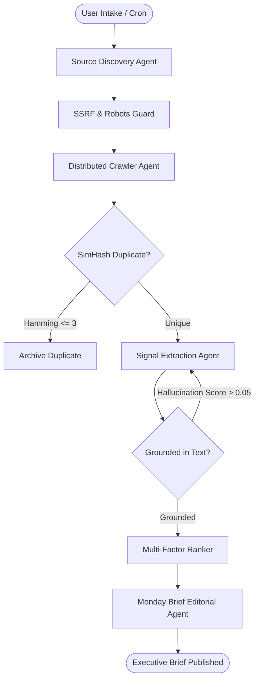

# Signal Stack — System Architecture Document
*Autonomous Strategic Intelligence Engine for Enterprise Leadership*

---

## 1. System Overview & Core Invariants

Signal Stack is an autonomous, multi-tenant strategic intelligence platform built to monitor, crawl, synthesize, and report high-conviction market signals for enterprise executives. It transforms noisy public and internal information into verified weekly intelligence briefs with mathematical traceability.

### Non-Negotiable Engineering Invariants
1. **Zero Hallucination Tolerance**: Every reported signal must link to an immutable snapshot and verifiable URL.
2. **Evidence vs. Interpretation Separation**: Public facts and AI strategic extrapolations are stored in distinct database columns.
3. **Multi-Tenant Isolation**: Complete database-level isolation enforced via PostgreSQL 17 Row-Level Security (RLS).
4. **Zero-Trust Crawler Guardrails**: SSRF IP blacklisting, polite rate limiting, robots.txt compliance, and 64-bit SimHash near-duplicate elimination.
5. **Zero Data Retention AI Gateway**: All LLM calls route through Cloudflare AI Gateway with zero logging of confidential prompts.

```
+---------------------------------------------------------------------------------------------------+
|                                  CLIENT & EDGE PRESENTATION TIER                                  |
|   TanStack Router + React 18 + Tailwind CSS + Lucide Icons (Cloudflare Pages Edge CDN)            |
+---------------------------------------------------------------------------------------------------+
                                                  | HTTPS / WSS
                                                  v
+---------------------------------------------------------------------------------------------------+
|                                  APPLICATION BACKEND RUNTIME                                      |
|   Cloudflare Worker (Hono RESTful API) + Node.js Compatibility + JWT / Supabase Auth              |
+---------------------------------------------------------------------------------------------------+
       |                                     |                                     |
       v                                     v                                     v
+-----------------------+     +-------------------------------+     +-------------------------------+
|   CRAWLER SUBSYSTEM   |     |    AI AGENT ORCHESTRATION     |     |      ENTERPRISE STORAGE       |
| - SSRF Guard (RFC1918)|     | - LangGraph State Graph       |     | - Supabase PostgreSQL 17      |
| - Robots.txt Cache    |     | - Groq Llama 3.3 70B (Fast)   |     | - pgvector (1536d Embeddings) |
| - SimHash 64-bit      |     | - Cloudflare AI Gateway       |     | - 43 Tables with Active RLS   |
| - Cloudflare Queues   |     | - Multi-Source Fact Check     |     | - Cloudflare KV & D1 Mirror   |
+-----------------------+     +-------------------------------+     +-------------------------------+
```

---

## 2. Multi-Agent Orchestration via LangGraph

Signal Stack implements a compiled, cyclical state graph that coordinates five autonomous specialized agents:



### Agent Responsibilities
1. **Source Discovery Agent**: Discovers company-specific sources dynamically using search APIs (Tavily), regulatory gazettes, and competitor sitemaps. Zero hardcoded directories.
2. **Distributed Crawler Agent**: Fetches and parses RSS, XML, HTML, and PDF documents. Runs under strict SSRF blacklists (blocking 10.0.0.0/8, 172.16.0.0/12, 192.168.0.0/16, 127.0.0.1, 169.254.169.254) with exponential backoff on HTTP 429/5xx.
3. **SimHash Deduplication Engine**: Computes 64-bit FNV-1a SimHash fingerprints. Flags documents with Hamming distance $le 3$ as near-duplicates.
4. **Signal Extraction Agent**: Distills raw text into candidate events. Strictly separates verifiable evidence quotes from strategic business interpretations.
5. **Multi-Factor Ranker & Editorial Agent**: Ranks signals using an explainable 6-factor composite formula and compiles the 10-part Monday Morning Executive Brief.

---

## 3. Storage Architecture & Multi-Tenant Security

The storage tier is powered by **Supabase PostgreSQL 17** equipped with `pgcrypto` and `vector`.

### Tenancy Model
Every table contains `organization_id` referencing the tenant. Row-Level Security (RLS) is strictly enabled across all 43 tables:

```sql
-- Zero-Trust Tenant Isolation Policy Pattern
CREATE POLICY tenant_isolation_policy ON signals
  FOR ALL
  TO authenticated
  USING (organization_id = (SELECT default_organization_id FROM user_profiles WHERE id = auth.uid()))
  WITH CHECK (organization_id = (SELECT default_organization_id FROM user_profiles WHERE id = auth.uid()));
```

### Schema Organization (43 Tables)
- **Identity & Access**: `organizations`, `user_profiles`, `organization_members`.
- **Company Intelligence**: `companies`, `company_profiles`, `company_profile_versions`, `company_research_facts`, `interview_sessions`, `interview_questions`, `interview_answers`.
- **Source Management**: `sources`, `competitors`, `source_discovery_runs`, `source_health_history`, `source_approvals`.
- **Crawler & Snapshot Storage**: `crawl_runs`, `crawl_records`, `crawl_failures`, `content_snapshots`.
- **Signal Intelligence**: `signals`, `signal_evidence`, `signal_entities`, `signal_relationships`, `signal_rank_history`.
- **Internal Intelligence**: `internal_documents`, `internal_uploads`, `internal_insights`, `internal_observations`.
- **Executive Reporting**: `briefs`, `brief_sections`, `brief_actions`, `brief_sources`, `brief_versions`.
- **Automation & Telemetry**: `automation_settings`, `scheduled_jobs`, `job_runs`, `job_locks`, `api_metrics`, `usage_records`, `audit_logs`, `audit_reports`, `system_events`.

---

## 4. Signal Scoring & Explainable Ranking Algorithm

Signals are prioritized through an explicit 6-factor scoring formula:

$$	ext{Ranking Score} = w_r cdot S_r + w_e cdot E_s + w_s cdot R_s + w_b cdot B_i + w_u cdot U + w_n cdot N$$

Where:
- $S_r$: Source Reliability (0.0 to 1.0) — verified regulatory domain = 0.98, unverified forum = 0.50.
- $E_s$: Evidence Strength (0.0 to 1.0) — statutory notification cite = 0.95, hearsay = 0.40.
- $R_s$: Strategic Relevance (0.0 to 1.0) — cosine similarity between signal embedding and Company Profile.
- $B_i$: Business Impact (0.0 to 1.0) — financial, legal, or operational magnitude.
- $U$: Urgency (0.0 to 1.0) — immediacy of executive action window (< 7 days = 1.0, > 90 days = 0.3).
- $N$: Novelty (0.0 to 1.0) — inverse semantic proximity to past 90 days of reported signals.

Weights default to:
$$w_r = 0.20, quad w_e = 0.20, quad w_s = 0.25, quad w_b = 0.15, quad w_u = 0.10, quad w_n = 0.10 quad left(sum w_i = 1.0
ight)$$

---

## 5. Deployment Topology & Operational Readiness

| Tier | Component | Infrastructure | Failover & Resilience |
| :--- | :--- | :--- | :--- |
| **Frontend** | Single Page Application | Cloudflare Pages (Global Anycast CDN) | Automated rollback, asset immutability |
| **API** | Hono REST API Worker | Cloudflare Workers (`nodejs_compat`) | 0ms cold starts, edge-distributed |
| **Queue** | Background Job Pipeline | Cloudflare Queues | 3 retries, Dead Letter Queue (DLQ) |
| **Database** | Relational & Vector DB | Supabase PostgreSQL 17 (ap-southeast-2)| Daily automated snapshots, WAL archiving |
| **LLM Gateway** | Inference Acceleration | Groq + Cloudflare AI Gateway | Fallback to secondary provider on 429/500 |
