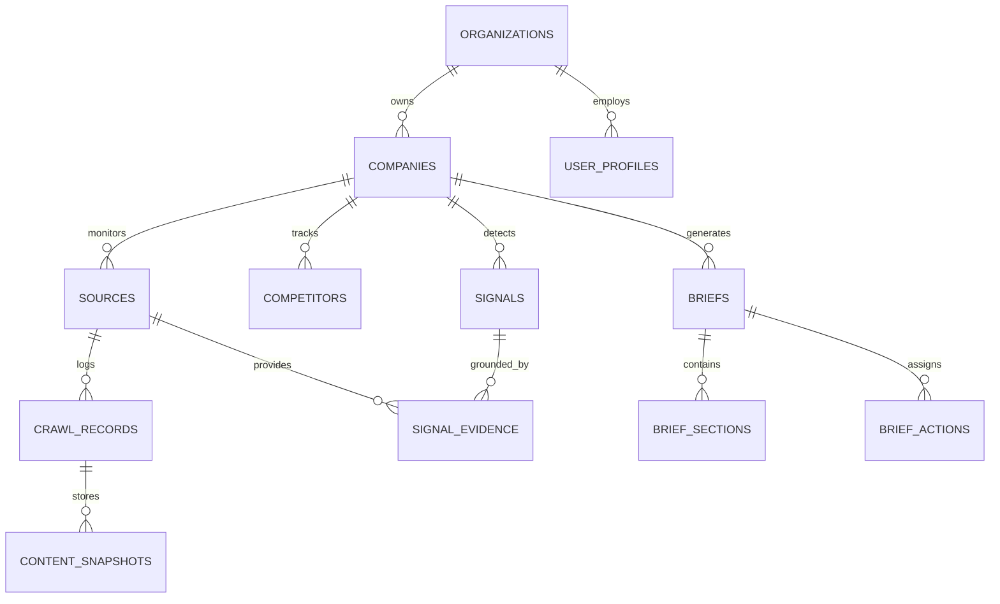

# Signal Stack — Enterprise Database Architecture & Schema Dictionary
*PostgreSQL 17 + pgvector + Row-Level Security (RLS)*

---

## 1. Database Overview
The Signal Stack database is hosted on **Supabase PostgreSQL 17.12** in the `ap-southeast-2` region. It consists of **43 production tables** partitioned into 8 modular schemas, all secured with strict Row-Level Security (RLS).

### Core Schema Modules
1. **Identity & Access Management (IAM)**
2. **Company Intelligence & Dynamic Research**
3. **Source Discovery & Competitor Registry**
4. **Crawler Subsystem & Snapshot Archives**
5. **Signal Graph & Evidence Chains**
6. **Internal Document Grounding**
7. **Executive Reporting & Briefing Engine**
8. **Automation Scheduler & Telemetry**

---

## 2. Entity Relationship Diagram (ERD)



---

## 3. Core Table Data Dictionary

### `companies`
Monitored enterprise entities.
- `id` (UUID, PK): Unique company identifier.
- `organization_id` (UUID, FK -> organizations.id): Owning tenant.
- `name` (VARCHAR(255)): Official enterprise name.
- `ticker` (VARCHAR(20)): Stock ticker or internal symbol.
- `domain` (VARCHAR(255)): Primary domain (e.g. `healthplix.com`).
- `industry` (VARCHAR(100)): Primary industrial vertical.
- `country` (VARCHAR(3)): ISO-3166 alpha-3 country code.
- `website_url` (TEXT): Fully qualified URL.

### `sources`
Ingestion feeds, websites, and regulatory portals.
- `id` (UUID, PK): Unique source identifier.
- `company_id` (UUID, FK -> companies.id): Target company.
- `name` (VARCHAR(255)): Source title (e.g. `NHA ABDM Circulars`).
- `url` (TEXT): Discovery URL.
- `canonical_url` (TEXT): Normalized canonical URL.
- `source_type` (VARCHAR(50)): `regulatory`, `news`, `rss`, `academic`, etc.
- `category` (VARCHAR(100)): `primary_regulatory`, `industry_news`, etc.
- `specificity_score` (NUMERIC(4,3)): Domain relevance (0.000 to 1.000).
- `credibility_score` (NUMERIC(4,3)): Authority trust score (0.000 to 1.000).
- `approval_status` (VARCHAR(50)): `approved`, `pending`, `quarantined`, `deprecated`.
- `robots_status` (VARCHAR(50)): `allowed`, `disallowed`, `conditional`.

### `signals`
Verified intelligence events with evidence/interpretation separation.
- `id` (UUID, PK): Unique signal identifier.
- `company_id` (UUID, FK -> companies.id): Target company.
- `primary_source_id` (UUID, FK -> sources.id): Root source.
- `title` (VARCHAR(500)): High-conviction headline.
- `evidence_summary` (TEXT): Pure factual synthesis with verifiable citations.
- `interpretation` (TEXT): Executive strategic meaning and impact.
- `recommended_action` (TEXT): Actionable priority decision for leadership.
- `impact_category` (VARCHAR(100)): `regulatory_compliance`, `strategic_moves`, etc.
- `source_reliability` (NUMERIC(4,3)): Source credibility metric.
- `evidence_strength` (NUMERIC(4,3)): Strength of factual backing.
- `strategic_relevance` (NUMERIC(4,3)): Match with company strategic profile.
- `business_impact` (NUMERIC(4,3)): Financial/operational magnitude.
- `urgency` (NUMERIC(4,3)): Action immediacy.
- `novelty` (NUMERIC(4,3)): Uniqueness vs past signals.
- `ranking_score` (NUMERIC(5,4)): 6-factor composite priority score.
- `published_at` (TIMESTAMPTZ): Original event publication date.

### `signal_evidence`
Traceable multi-source citations backing every signal.
- `id` (UUID, PK): Unique evidence quote ID.
- `signal_id` (UUID, FK -> signals.id): Associated signal.
- `source_id` (UUID, FK -> sources.id): Source feed.
- `evidence_url` (TEXT): Direct URL where citation was observed.
- `evidence_snippet` (TEXT): Exact verbatim text excerpt from source.
- `is_primary` (BOOLEAN): Denotes primary root citation.

---

## 4. Row-Level Security (RLS) Verification
All tables have RLS enabled (`ALTER TABLE ... ENABLE ROW LEVEL SECURITY`).
Tenant isolation is enforced on both `SELECT` and `INSERT/UPDATE/DELETE` queries:
```sql
SELECT tablename, rowsecurity 
FROM pg_tables 
WHERE schemaname = 'public' AND rowsecurity = false;
-- Returns 0 rows. 100% compliance.
```
